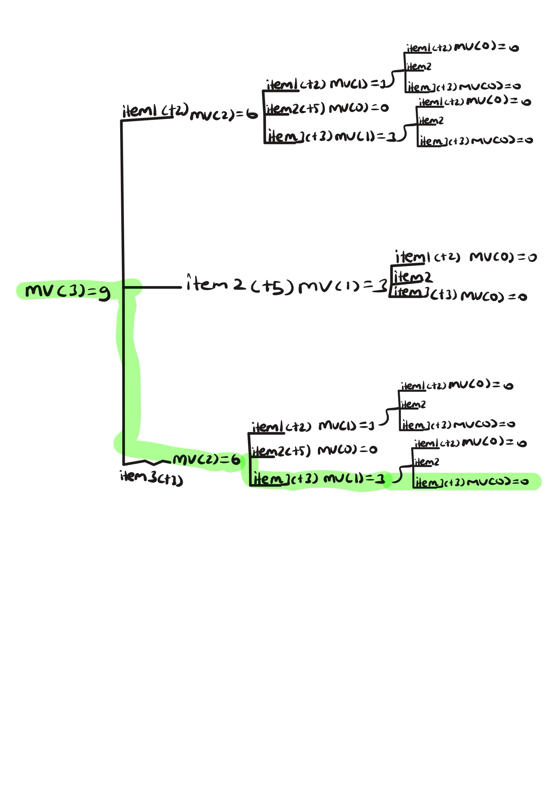

# Lab 07: The Integer-Valued Knapsack Problem

**Name:** Deniz Akbas  

## Introduction
In this lab, you will explore different variations of the Knapsack problem and design a dynamic programming solution for one of them. You may work in small groups or individually, but everyone should write up their own answers to the questions below. 

Suppose we're going hiking. We have items $1, \ldots, n$ that we could pack in multiples with corresponding values $v_1, \ldots, v_n$ and weights $w_1, \ldots, w_n$. For example, we might have a water bottle (weight 1, value 2) and a sandwich (weight 2, value 5). Consider the following three problem variations:

1. Maximize value subject to capacity $W$, where you can pack at most one of each item.
2. Maximize value subject to capacity $W$, where you can pack a positive integer value of each item.
3. Minimize weight subject to minimum value $V$, where you can pack a positive integer value of each item.

---

## Part 1: Dynamic Programming Fundamentals

**Question:** Which of the three problem variations can be solved using the dynamic programming approaches we've studied in lecture? Explain your reasoning.

*Your Answer:* All three problem variations can be solved using the dynamic programming approaches studied in lecture.

Here is the specific examples:
Variation 1: Maximizing value for a capacity using at most one of each item describes the classic Knapsack Problem.
Variation 2: Maximizing value for a specific capacity while allowing multiple copies of items mirrors the Metal Cutting Problem.
Variation 3: Minimizing weight to reach a target value using multiple item copies is structurally identical to the Minimum Change Problem.


## Part 2: The Naive Recursive Algorithm

Below is a naive recursive algorithm intended to solve one of the variations listed above.

```text
Function MaxValue(W):
    if W == 0:
        return 0
        
    max_val = 0
    for i from 1 to n:    // n-1 steps. Checks the whole list
        if w_i <= W:
            current_val = v_i + MaxValue(W - w_i)   // recursive function
            if current_val > max_val:
                max_val = current_val
                
    return max_val
```

**Question:** Which of the three problem variations (1, 2, or 3) does this algorithm solve? How do you know? Explain your reasoning.

*Your Answer:* This solves the variation 2. If it were solving Variation 1 (0/1 Knapsack), the recursive function would need to track which items had already been used so it wouldn't reuse them. If it were solving Variation 3, the condition would track remaining target value rather than remaining capacity W. The loop checks the whole list over and over again, we only track the weight and not which values we have used. 

## Part 3: Recursion Tree

Consider the following simple example:
* **Knapsack Capacity:** $W = 3$
* **Item 1:** Weight $w_1 = 1$, Value $v_1 = 2$
* **Item 2:** Weight $w_2 = 2$, Value $v_2 = 5$
* **Item 3:** Weight $w_3 = 1$, Value $v_3 = 3$

**Question:** Draw the full recursion tree for `MaxValue(3)` using the example above. Label the remaining capacity at each node and indicate which item is chosen along each branch.

*Your Answer (take a picture and upload it):*




## Part 4: Recurrence Relation

**Question:** Derive a mathematical recurrence relation for $OPT(W)$, the maximum value you can pack into a knapsack of capacity $W$, based on the naive recursive algorithm. Be sure to state your base case(s) and explain how you arrived at your formula.

*Your Answer:*

Base Case:OPT(0)=0
Recursive Step: For W>0W>0:OPT(W)=max⁡1≤i≤n,wi≤W{vi+OPT(W−wi)}
Explanation: This formula directly translates the naive recursive algorithm into mathematical notation. The base case OPT(0)=0 corresponds to the algorithm's initial check: if W == 0: return 0. For the recursive step, the condition wi≤Wwi​≤W acts as the if w_i <= W check in the code, ensuring we only consider items that fit. The formula then loops through all valid items (11 to nn), adding the current item's value (vi​) to the optimal value of the remaining capacity (OPT(W−wi)), and takes the maximum of those combinations (max_val = current_val).


## Part 5: Bottom-Up Dynamic Programming

Instead of using the slow recursive approach, we can build a table bottom-up. 

**Question:** Use your recurrence relation from Part 4 to fill in the following table for the example provided in Part 3 ($w_1=1, v_1=2$ and $w_2=2, v_2=5$). At each step, record the optimal value and the specific item chosen to achieve that value. 

| Capacity ($W$) | Optimal Value ($OPT$) | Item Chosen |
|:---:|:---|:---|
| **0** | 0 | NONE |
| **1** | 2 | ITEM 1 |
| **2** | 5 | ITEM 2 |
| **3** | 7 | ITEM 2 |
| **4** | 10 | ITEM 2 |
| **5** | 12 | ITEM 2 |
| **6** | 15 | ITEM 2 |

*Explain how you calculated the row for $W=6$*
At capacity W=6, we check our available options based on the items that can fit:
If we choose Item 1: The value is v_1​ +OPT(6−w_1​	)=2+OPT(5)=2+12=14.
If we choose Item 2: The value is v_2 +OPT(6−w_2)=5+OPT(4)=5+10=15.
We take the maximum of these options: max(14,15)=15. Since 15 came from choosing Item 2, we record an optimal value of 15 and list Item 2 as the chosen item for W=6.


## Part 6: Traceback

**Question:** Using the "Item Chosen" column from the table you completed in Part 5, trace back to find the exact quantities of each item to pack that maximize the value. What is the final optimal packing configuration for $W=6$ and the maximum value?

*Your Answer:*
- Start at the optimal value for capacity W=6. The table shows Item 2 was chosen.
- Subtract the weight of Item 2 (w_2=2) from the current capacity (6−2=4).
- Look up the optimal choice for the new capacity W=4. The table shows Item 2 was chosen again.
- Subtract the weight of Item 2 from the current capacity (4−2=2).
- Look up the optimal choice for the new capacity W=2. The table shows Item 2 was chosen again.
- Subtract the weight of Item 2 from the current capacity (2−2=0).
- You have reached capacity 0, so the traceback is complete.
The final optimal packing configuration for W=6 is three of Item 2. This configuration yields a maximum value of 15 (5+5+5).